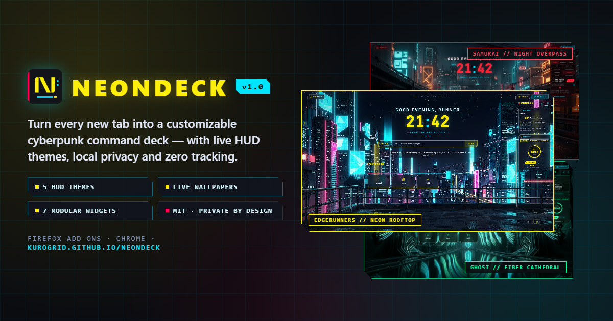
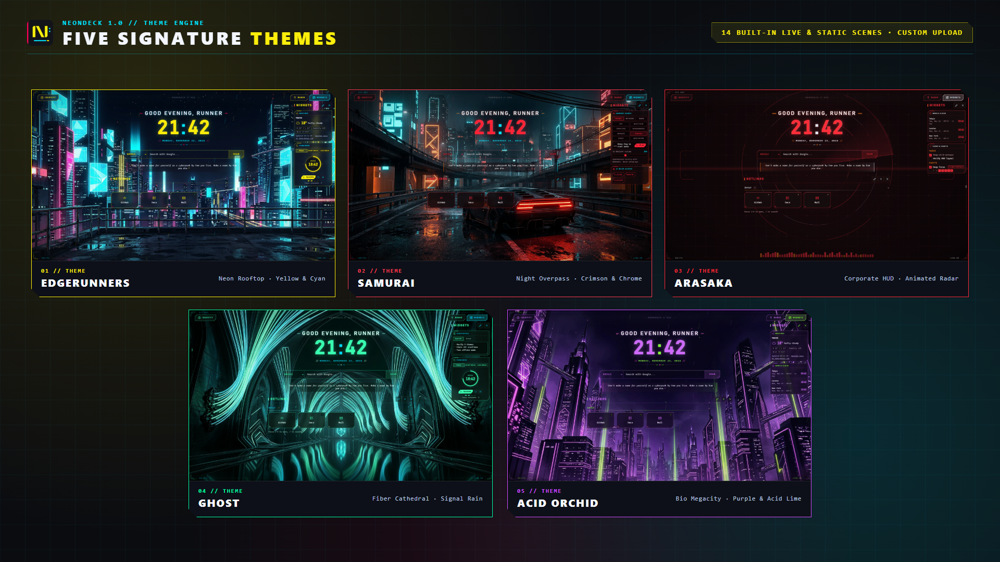
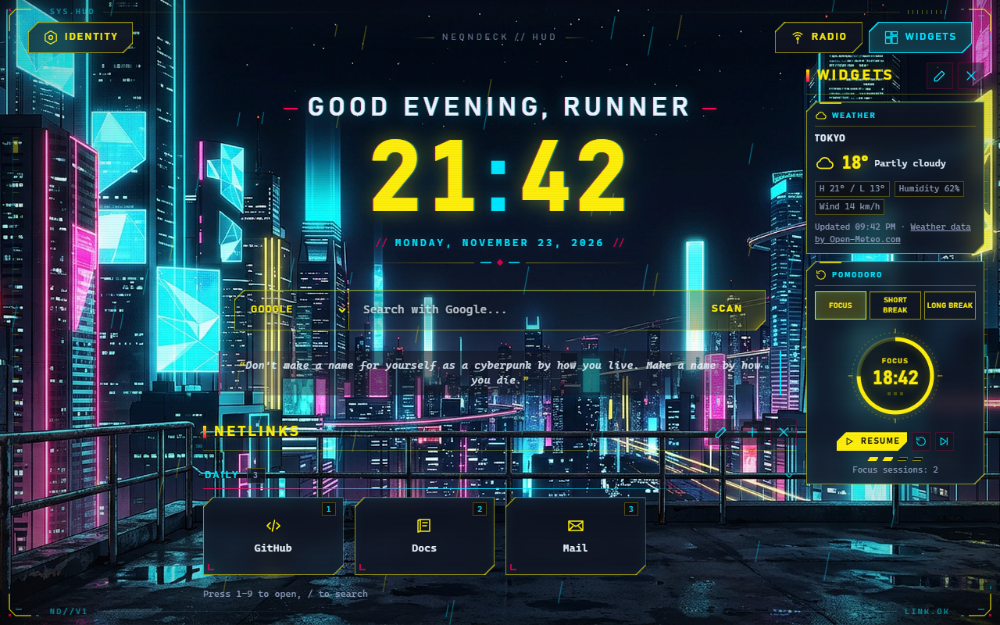
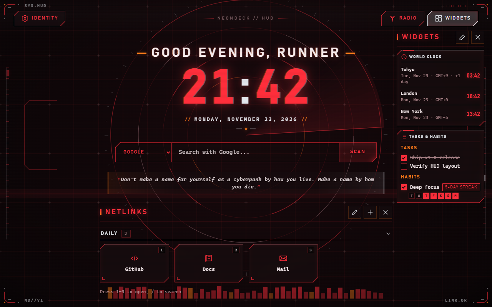
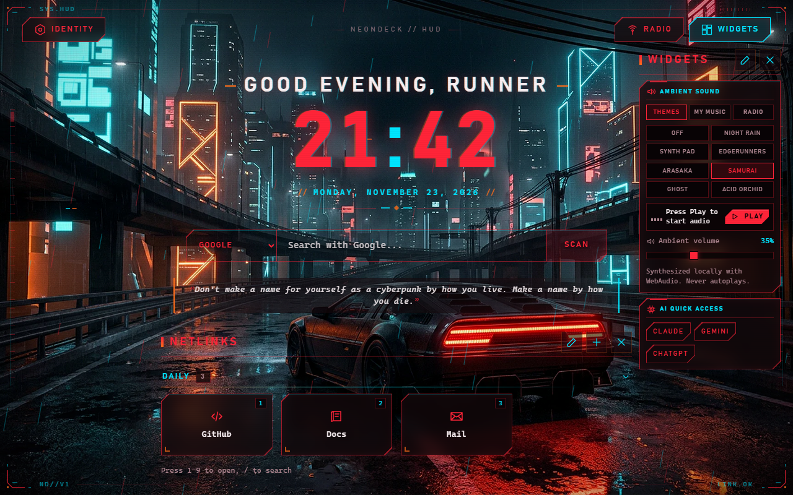
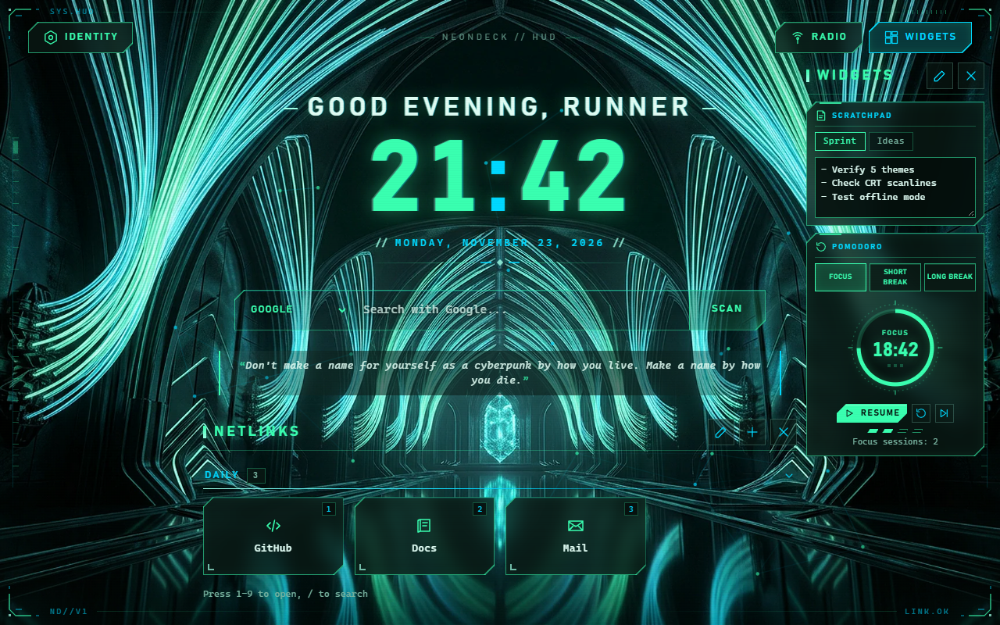
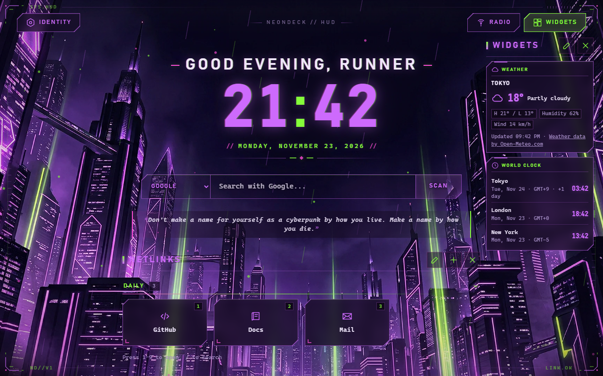
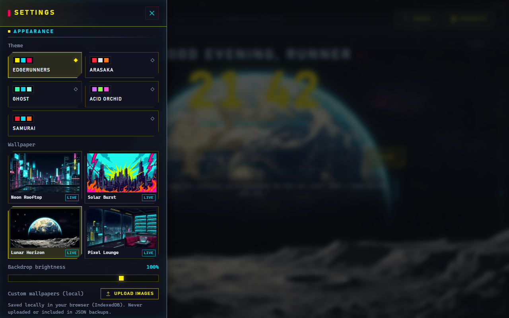
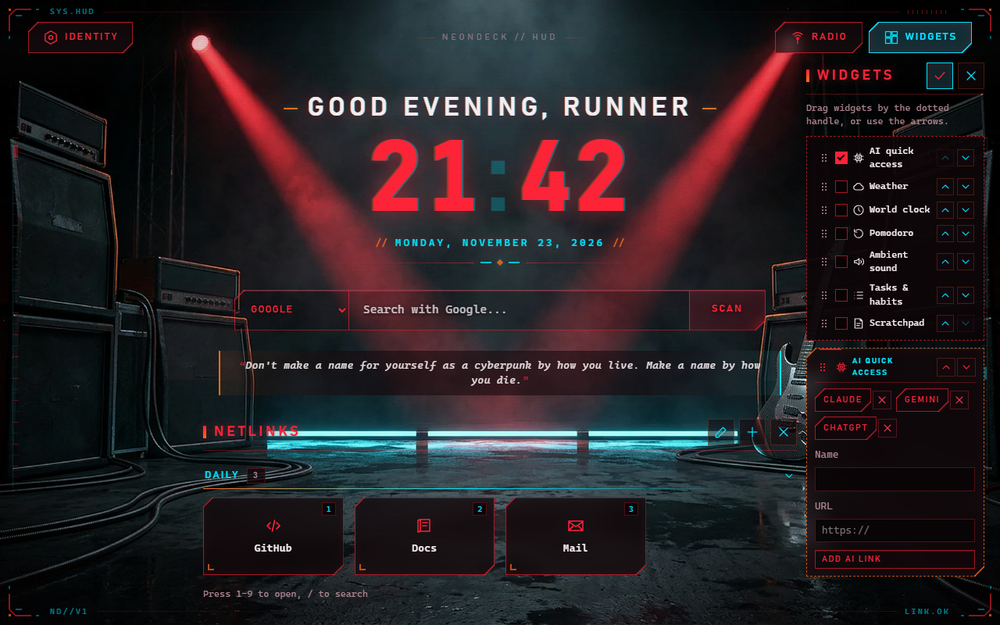

# NEONDECK



[](https://github.com/Kurogrid/neondeck-extension/actions/workflows/ci.yml) [](LICENSE)

A cyberpunk HUD new tab dashboard for Firefox and Chrome: big clock, multi-engine search, netlinks with keyboard shortcuts, and a side panel of focus widgets. Private by design: no account, no tracking, no remote code.

> **Status: 1.1.0 stable.** Five themes with live wallpapers and animated canvas backgrounds, HUD frames, CRT and glitch effects, theme music, a local music player, an optional Spotify radio and a full widget panel.

_Türkçe özet aşağıda._

## Features
- **Command deck**: greeting, clock and date (12/24-hour), search with Google, DuckDuckGo, Bing, Brave, ChatGPT, Perplexity, YouTube or your own engine. `/` focuses search, `1`–`9` open your top links.
- **Netlinks**: saved sites as cards in collapsible categories; import browser bookmarks (optional permission).
- **Widgets** (side panel, drag to reorder): weather (Open-Meteo), world clock, scratchpad, tasks and habits with streaks, Pomodoro, AI quick links.
- **Themes**: Edgerunners, Arasaka, Ghost, Acid Orchid, Samurai, each with its own live wallpapers or animated background; upload your own wallpaper; scanlines, glitch and vignette effects; low power mode.
- **Sound**: optional UI sounds and an ambient widget (rain, synth pad), synthesized locally with WebAudio, never autoplays.
- **Data**: everything stays in local extension storage; JSON export/import (also imports exports from the Cyberstart extension).
- **Languages**: English, Turkish.

## Screenshots


| | |
|---|---|
|  |  |
|  |  |
|  |  |
|  | |

## Install
- **Firefox**: [NEONDECK on Firefox Add-ons](https://addons.mozilla.org/firefox/addon/neondeck/).
- **From source**: build it (below), then
  - Firefox: `about:debugging` → This Firefox → Load Temporary Add-on → `dist-firefox/manifest.json`
  - Chrome: `chrome://extensions` → Developer mode → Load unpacked → `dist/`

## Build
Requires Node.js 24 and npm 11.

```bash
npm ci
npm run verify          # type-check, tests, Chrome build, manifest checks
npm run build:firefox   # Firefox build in dist-firefox/
npm run package         # release zips in release/ (needs a clean git tree)
```

Details for reproducible builds: [BUILD.md](BUILD.md).

## Privacy
NEONDECK installs with the `storage` permission only. The weather widget sends the chosen city and rounded coordinates to Open-Meteo, only after you opt in (Firefox asks for location-data consent). Nothing is sent to the developer. Full policy: https://kurogrid.github.io/neondeck/privacy

## Project layout
- `src/core/`: storage, schema and migrations, validation, permissions, i18n
- `src/widgets/`: widget logic (pure, tested) and views
- `src/components/`: UI components (Preact)
- `public/`: manifest, locales, icons
- `scripts/`: Firefox build, packaging, manifest checks

## License
[MIT](LICENSE) © 2026 Kurogrid. Third-party notices: [LICENSES.md](LICENSES.md).

NEONDECK is an independent project and is not affiliated with any game, film or brand.

---

## Türkçe özet
NEONDECK, Firefox ve Chrome için cyberpunk HUD tarzı bir yeni sekme panosudur: büyük saat, çoklu arama motoru, kısayollu netlink'ler ve yan panelde odak widget'ları (hava durumu, dünya saati, not defteri, görev ve alışkanlıklar, Pomodoro, AI bağlantıları). Hesap yok, izleme yok; veriler tarayıcında kalır. Şu an **1.1.0** kararlı sürümündedir: beş temanın her biri kendi canlı duvar kağıtları ya da hareketli arka planıyla geliyor; CRT ve glitch efektleri, tema müzikleri, yerel müzik çalar, opsiyonel Spotify radyosu ve widget paneli hazır. Derleme adımları yukarıda, lisans MIT.
